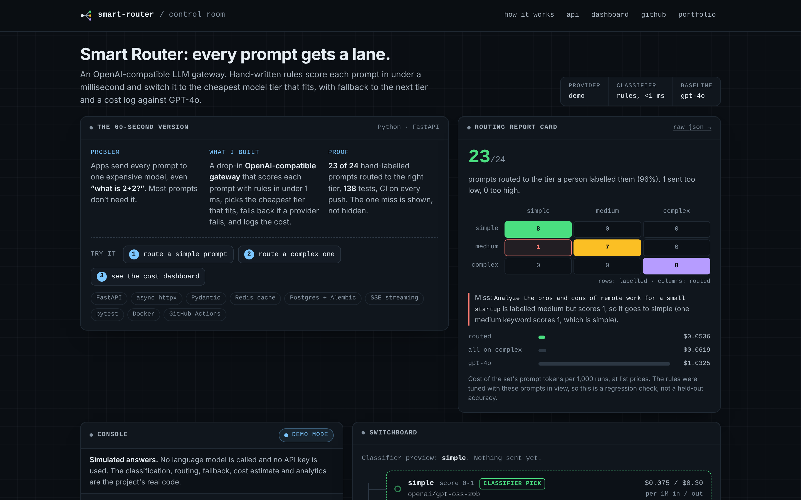

# Smart Router

[](https://github.com/Nityaa08/smart-router/actions/workflows/ci.yml)

**Live demo: [smart-router-nityashree.vercel.app](https://smart-router-nityashree.vercel.app)** (simulated answers, no API key) · by [Nityashree S](https://nityashree.in)

> **An OpenAI-compatible LLM gateway that routes each prompt to one of three model tiers using hand-written rules, and estimates the cost of every request.**

[](https://smart-router-nityashree.vercel.app)

---

## The Problem

Every prompt you send to GPT-4o is billed at the same per-token price — whether you're asking *"what is 2+2?"* or *"design a distributed caching system."* Many prompts are short and simple, so sending all of them to a frontier model may cost more than needed. Smart Router explores that idea: it routes by rules and records what each request would have cost on GPT-4o.

## What It Does

Smart Router sits between your app and your LLMs. It classifies each prompt using zero-cost heuristic rules (no API call), routes it to the model configured for that tier, logs every decision, and estimates the cost difference against GPT-4o list prices.


Each tier maps to a model you set in `.env`. **About the savings number:** it compares the price-table cost of the model used with GPT-4o list prices for the same token counts. It is not a measured saving — see [Known Limitations](#known-limitations-checked-2026-11-13).

---

## The Live Demo

The public demo runs this code on Vercel's free tier in **demo mode** (`PROVIDER=demo`):

- **No language model is called and no API key exists in the deployment.** Each tier is a `DemoProvider` that returns a clearly labelled simulated answer. Token counts are estimates (prompt length / 4, and a typical answer length per tier).
- **Everything else is the real code:** the classifier, routing, tier fallback, cost estimate at list prices, rate limit and analytics.
- The page at `/` shows, for any prompt, the tier, the score and every rule that fired (from `POST /v1/route/explain`), the estimated cost against GPT-4o and the simulated answer. The original dashboard is at `/dashboard`.
- There is no Postgres or Redis on the demo: `DATABASE_URL=memory` keeps the request log in the function's memory (so `/analytics` covers one instance and resets), and `REDIS_URL=none` turns the cache off.
- Guards for a public URL: 20 requests a minute per client IP (`RATE_LIMIT`, counted per instance), prompts up to 2,000 characters (`MAX_PROMPT_CHARS`), and the client IP taken from Vercel's `X-Real-IP` header (`TRUST_PROXY_HEADERS=true`).

**To make the demo answer with real models** (free): create a Groq API key at [console.groq.com](https://console.groq.com), then in the Vercel project settings set `PROVIDER=groq`, `GROQ_API_KEY=<key>` and `MAX_COMPLETION_TOKENS=300`, and redeploy. The key stays in Vercel's encrypted environment variables, never in the repository. The page then says "Live" instead of "Demo mode".

---

## Example requests

```bash
# Simple question → routes to cheapest model
curl -X POST http://localhost:8000/v1/chat/completions \
  -H "Content-Type: application/json" \
  -d '{"messages":[{"role":"user","content":"What is 2+2?"}]}'

# Response headers:
# X-Router-Tier:  simple
# X-Router-Model: llama3.2:1b
# X-Cost-Saved:   0.00016959

# Complex prompt → escalates automatically
curl -X POST http://localhost:8000/v1/chat/completions \
  -d '{"messages":[{"role":"user","content":"Implement quicksort with complexity analysis"}]}'

# X-Router-Tier:  complex
# X-Router-Model: llama3.1:8b

# Why? The rules that fired, with no model call
curl -X POST http://localhost:8000/v1/route/explain \
  -H "Content-Type: application/json" \
  -d '{"messages":[{"role":"user","content":"Implement quicksort with complexity analysis"}]}'
```

---

## Features

| Feature | Detail |
|---|---|
| **Zero-cost classifier** | Rule-based scoring on token count, keywords, code patterns — no LLM, no API call |
| **OpenAI-compatible API** | Drop-in `POST /v1/chat/completions` — works with any OpenAI SDK |
| **5 provider options** | Ollama (local) · OpenRouter (free) · Groq (free) · Any OpenAI-compatible API · `demo` (simulated, no key) |
| **Explainable routing** | `POST /v1/route/explain` returns the score, every rule that fired and the per-tier models, without calling a model |
| **Router response headers** | `X-Router-Tier`, `X-Router-Model`, `X-Cost-Saved` on every response |
| **Redis caching** | Identical prompts served from cache (SHA-256 keyed, 1hr TTL) |
| **Cost analytics dashboard** | `GET /analytics` — estimated cost, estimated savings vs. GPT-4o list prices, per-tier breakdown |
| **Fallback escalation** | Provider fails → automatically escalates to next tier |
| **Playground and dashboard** | `/` is a playground that shows each routing decision; `/dashboard` shows routing distribution and estimated cost |
| **Optional API key** | Set `ROUTER_API_KEY` to require `Authorization: Bearer <key>` on the chat and analytics endpoints |
| **Rate limit** | `RATE_LIMIT` per client IP on `POST /v1/chat/completions` (HTTP 429 when exceeded) |
| **90 unit tests** | Classifier, cost calculation, the chat endpoint (routing, fallback, streaming, cache, rate limit, auth) with fake providers, and the demo mode (demo provider, in-memory log, explain endpoint, guards) |

---

## Quick Start

### Option 0 — Demo mode (no Docker, no model, no key)

```bash
cd backend
pip install -r requirements.txt
PROVIDER=demo DATABASE_URL=memory REDIS_URL=none uvicorn app.main:app --reload
open http://localhost:8000
```

This is what the live demo runs. Answers are simulated; everything else is real.

### Option A — Ollama (local, no accounts needed)

```bash
# 1. Install Ollama and pull models (~5 GB)
brew install ollama
ollama serve                   # keep this running in a terminal
ollama pull llama3.2:1b
ollama pull llama3.1:8b

# 2. Clone and start the stack
git clone https://github.com/Nityaa08/smart-router
cd smart-router
cp .env.example .env           # PROVIDER=ollama is already set
make dev

# 3. Open dashboard
open http://localhost:8000
```

### Option B — OpenRouter (free cloud, no credit card needed)

The default models are free (`:free`) models that OpenRouter listed on 2026-11-02 (`google/gemma-4-26b-a4b-it:free`, `google/gemma-4-31b-it:free`, `nvidia/nemotron-3-ultra-550b-a55b:free`). OpenRouter's free list changes often; if a request returns 404, pick current IDs from [openrouter.ai/api/v1/models?max_price=0](https://openrouter.ai/api/v1/models?max_price=0) and set them in `.env`.

```bash
# 1. Sign up at openrouter.ai → Keys → Create Key

# 2. Edit .env:
PROVIDER=openrouter
OPENROUTER_API_KEY=sk-or-your-key-here

make dev
```

### Option C — Groq (free cloud)

The defaults are `openai/gpt-oss-20b` (simple) and `openai/gpt-oss-120b` (medium, complex), both production models on [Groq's model list](https://console.groq.com/docs/models) on 2026-11-02. Groq retired the earlier defaults (see [Groq deprecations](https://console.groq.com/docs/deprecations)).

```bash
# 1. Sign up at console.groq.com → API Keys

# 2. Edit .env:
PROVIDER=groq
GROQ_API_KEY=gsk_your-key-here

make dev
```

---

## How the Classifier Works

No LLM is called for classification. A scoring function evaluates signals in <1ms:

| Signal | Points |
|---|---|
| Token count < 100 | +2 (simple signal) |
| Keywords: "what is", "define", "translate", "summarize" | +2 |
| Keywords: "explain", "compare", "analyze", "write a" | +1 |
| Code patterns (` ``` `, `def`, `class`, `function`) | +2 |
| Multi-step patterns ("first… then…", numbered steps) | +2 |
| Math/logic ("prove", "derive", "algorithm", "complexity") | +2 |
| Token count > 500 | +2 (complex signal) |

**Score ≤ 4 → simple · Score 5–7 → medium · Score ≥ 8 → complex**

---

## API Reference

### `POST /v1/chat/completions`
OpenAI-compatible chat endpoint.

```json
{
  "messages": [{"role": "user", "content": "..."}],
  "force_tier": null,
  "stream": false
}
```

`"stream": true` returns OpenAI-style `chat.completion.chunk` Server-Sent Events ending in `data: [DONE]`, with the `X-Router-Tier` and `X-Router-Model` headers. If a provider fails before its first chunk, the stream falls back to the next tier up, like non-streamed requests, and `X-Router-Fallback: true` says so. Only if every tier fails is the response HTTP 503. Streamed requests are not cached or logged (see Known Limitations).

If `ROUTER_API_KEY` is set, send `Authorization: Bearer <key>` (or `X-API-Key: <key>`); otherwise the response is HTTP 401. Requests over `RATE_LIMIT` get HTTP 429. The limit counts per API key when one is sent (hashed, never stored raw), otherwise per client IP.

Response includes a `router` field:
```json
{
  "router": {
    "tier": "simple",
    "model": "llama3.2:1b",
    "provider": "ollama",
    "actual_cost_usd": 0.0000004,
    "cost_saved_usd": 0.00017,
    "latency_ms": 2243,
    "from_cache": false
  }
}
```

### `GET /analytics`
`cache_hits` counts requests answered from Redis. A cache hit is logged with zero cost, and the GPT-4o price of its tokens counts as saved; `avg_latency_ms` covers provider calls only. Requires the API key if `ROUTER_API_KEY` is set.

Example shape (illustrative values):
```json
{
  "total_requests": 1234,
  "actual_cost_usd": 0.12,
  "baseline_cost_usd": 8.70,
  "total_saved_usd": 8.58,
  "savings_pct": 98.6,
  "by_tier": { "simple": {...}, "medium": {...}, "complex": {...} },
  "avg_latency_ms": 380,
  "cache_hits": 45
}
```

### `GET /health`
```json
{"status": "ok", "db": "up", "provider": "up", "provider_name": "ollama"}
```

---

## Running Tests

```bash
# Unit tests (no database or LLM required — runs in CI)
make unit-test

# Integration smoke tests (requires running stack)
make test
```

The unit test suite has 90 tests (30 classifier, 22 config/cost/default-model, 24 API, 14 demo mode) with zero external dependencies: the API tests replace the LLM providers, Redis and the Postgres logger with in-memory fakes. Line coverage on 2026-11-02: 100% of `classifier/heuristics.py`, `config.py` and `security.py`, 87% of `api/chat.py`, 81% of `router/engine.py`, 71% of the app overall. The provider HTTP clients and `/analytics` SQL are not unit-tested; the fake-model run below covers them end to end.

`make test` prints the HTTP status and the `x-router-tier` / `x-router-model` headers. If you set `ROUTER_API_KEY`, run `make test ROUTER_API_KEY=your-key`.

---

## Run With a Fake Model (no account, no API key)

This checks the whole stack (routing, Postgres log, Redis cache, analytics) without any LLM provider. The fake answers in the OpenAI format with fixed text and fixed token counts, so cost numbers come only from the price table.

1. Start Docker Desktop. Then create a virtual environment and the fake server (terminal 2):

```bash
cd backend
uv venv --python 3.12 .venv
uv pip install --python .venv/bin/python -r requirements.txt
cat > fake_llm.py <<'EOF'
import json
from fastapi import FastAPI, Request
from fastapi.responses import JSONResponse, StreamingResponse

app = FastAPI()

@app.get("/v1/models")
async def models():
    return {"data": [{"id": "fake"}]}

@app.post("/v1/chat/completions")
async def chat(request: Request):
    body = await request.json()
    model = body.get("model", "fake")
    question = body["messages"][-1]["content"]
    answer = f"[fake answer from {model}] You asked: {question[:40]}"
    if body.get("stream"):
        def gen():
            for word in answer.split():
                chunk = {"choices": [{"delta": {"content": word + " "}}]}
                yield f"data: {json.dumps(chunk)}\n\n"
            yield "data: [DONE]\n\n"
        return StreamingResponse(gen(), media_type="text/event-stream")
    return JSONResponse({
        "choices": [{"message": {"role": "assistant", "content": answer}}],
        "usage": {"prompt_tokens": 50, "completion_tokens": 200},
    })
EOF
.venv/bin/uvicorn fake_llm:app --host 0.0.0.0 --port 9100
```

2. In terminal 1, copy `.env.example` to `.env` and set these lines:

```bash
PROVIDER=openai_compat
OPENAI_COMPAT_BASE_URL=http://host.docker.internal:9100/v1
OPENAI_COMPAT_API_KEY=not-a-real-key
OPENAI_COMPAT_SIMPLE_MODEL=llama3.2:1b
OPENAI_COMPAT_MEDIUM_MODEL=llama3.1:8b
OPENAI_COMPAT_COMPLEX_MODEL=llama3.1:8b
```

3. Run `make dev`, then `make test`. Checked on 2026-10-28: health is `ok`, both prompts return HTTP 200, and `/analytics` shows 2 requests. Run `make clean` when done.

On 2026-11-02 streaming and the rate limit were checked against the same fake server (API run with uvicorn, without Postgres or Redis): `"stream": true` returned the chunks and `[DONE]`, and with `RATE_LIMIT=5/minute` the sixth request got HTTP 429. The full Docker stack was not re-run that day.

---

## Known Limitations (checked 2026-11-13)

- **Savings are an estimate, not a measurement.** `cost_saved` prices the tokens the chosen model used at GPT-4o list prices (from `config.py`) and subtracts the chosen model's price. Answer quality is not compared, and there is no evaluation set yet. The small-model prices for local Ollama models are assumptions.
- **The classifier is unvalidated.** It uses hand-written rules. "Simple" keywords add points to the score, so several simple questions in one prompt can be routed to `medium`.
- **Streaming is simpler than the non-streaming path.** Streamed requests fall back to the next tier only before their first chunk (a provider that fails mid-stream reports the error in the stream). They are not cached and not logged, so they do not appear in `/analytics`.
- **Authentication is one optional shared key.** With `ROUTER_API_KEY` unset (the default, for local dev) any client that can reach the server can send requests. There are no per-user keys or quotas. `/health` and the dashboard page stay public. CORS defaults to `*`.
- **Rate-limit counts are only shared when Redis is used.** Limits are per API key (or per IP when no key is sent). With `RATE_LIMIT_STORAGE=memory://`, each process counts separately. Docker Compose points it at the bundled Redis, so all workers share one count; if Redis goes down, counting falls back to each process.
- **Default cloud model IDs will go out of date again.** The defaults were checked on 2026-11-02 against [Groq's model list](https://console.groq.com/docs/models) and [OpenRouter's free-model list](https://openrouter.ai/api/v1/models?max_price=0). Free OpenRouter models in particular are added and removed often. If you change models, add paid ones to `MODEL_PRICING`: unknown models are priced as GPT-4o (no saving shown); any `:free` model is priced at 0.
- **Prices are hard-coded** in `config.py` (Groq prices checked 2026-11-02).
- **The live demo shows the pipeline, not model quality.** In demo mode answers are simulated and token counts are estimated, so its cost figures illustrate the pricing logic only. Its `/analytics` numbers live in one serverless instance's memory and reset when the instance is recycled, and its rate limit is counted per instance.

---

## Self-Hosting with Docker

The included `Dockerfile` builds a production-ready image. You can run it on any Docker host:

```bash
# Build
docker build -t smart-router ./backend

# Run with Postgres and Redis
docker compose up --build -d
```

Environment variables:

| Variable | Description |
|---|---|
| `PROVIDER` | `ollama` \| `openrouter` \| `groq` \| `openai_compat` |
| `OPENROUTER_API_KEY` | Required for OpenRouter |
| `GROQ_API_KEY` | Required for Groq |
| `DATABASE_URL` | PostgreSQL connection string |
| `REDIS_URL` | Redis connection string |
| `RATE_LIMIT` | Per-key (or per-IP) limit on `POST /v1/chat/completions` and `/v1/route/explain`, e.g. `60/minute` |
| `ROUTER_API_KEY` | Optional. If set, chat and analytics require `Authorization: Bearer <key>` |
| `MAX_PROMPT_CHARS` | Optional. Longer prompts get HTTP 413 (0 = no limit) |
| `MAX_COMPLETION_TOKENS` | Optional. Caps `max_tokens` sent to the provider (0 = no cap) |
| `TRUST_PROXY_HEADERS` | `true` only behind a proxy that sets `X-Real-IP` itself (e.g. Vercel) |

`DATABASE_URL=memory` keeps the request log in memory instead of Postgres; `REDIS_URL=none` turns the cache off.

See `.env.example` for the full list.

---

## Project Structure

```
smart-router/
├── docker-compose.yml        # Local dev: Postgres + Redis + API
├── .env.example              # Copy to .env, fill in API key
├── Makefile                  # make dev / test / unit-test / logs / clean
├── .github/
│   └── workflows/ci.yml      # CI: unit tests + Docker build on every push
└── backend/
    ├── Dockerfile            # Production-ready (non-root, healthcheck, auto-migrate)
    ├── index.py              # Vercel entrypoint (imports app.main:app)
    ├── start.sh              # Runs migrations then starts server
    ├── requirements.txt
    ├── alembic.ini
    ├── migrations/           # Alembic schema migrations
    ├── tests/
    │   ├── test_classifier.py  # 30 classifier unit tests
    │   ├── test_config.py      # 22 config/cost/default-model tests
    │   ├── test_api.py         # 24 chat-endpoint tests with fake providers
    │   └── test_demo.py        # 14 demo-mode tests
    └── app/
        ├── main.py           # FastAPI app (CORS, rate-limit handler, static files)
        ├── security.py       # Rate limiter + optional API key check
        ├── config.py         # Settings + DATABASE_URL scheme normalizer
        ├── database.py       # Async SQLAlchemy
        ├── classifier/       # Zero-cost heuristic scorer
        ├── providers/        # Ollama · Groq · OpenRouter · Generic OpenAI-compat · Demo
        ├── router/           # classify → route → log (Postgres, or memlog.py in memory)
        ├── api/              # /v1/chat/completions · /v1/route/explain · /analytics · /health
        ├── models/           # RequestLog ORM
        └── static/           # demo.html (playground at /) · index.html (dashboard at /dashboard)
```

---

## Commands

```bash
make dev          # build and start everything (Postgres + Redis + API)
make unit-test    # run unit tests locally (no services needed)
make test         # end-to-end smoke tests against all endpoints
make logs         # tail API logs
make stop         # stop containers (keep data)
make clean        # stop + wipe database
```

---

## Tech Stack

| Layer | Technology |
|---|---|
| API | FastAPI (async) |
| Database | PostgreSQL 16 + SQLAlchemy 2.0 (async) + Alembic |
| Cache | Redis 7 |
| LLMs | Ollama · OpenRouter · Groq · Any OpenAI-compatible endpoint |
| Classifier | Heuristic rules (zero cost, <1ms) |
| Infrastructure | Docker Compose |
| CI | GitHub Actions (unit tests + Docker build) |

---

## Deployment

- **Live demo:** Vercel (free tier), project root `backend/`, entrypoint `backend/index.py`, Python 3.12 (`backend/.python-version`). Environment variables: `PROVIDER=demo`, `DATABASE_URL=memory`, `REDIS_URL=none`, `RATE_LIMIT=20/minute`, `MAX_PROMPT_CHARS=2000`, `TRUST_PROXY_HEADERS=true`. Every push to `main` redeploys.
- **Full stack (Postgres + Redis + a real provider):** Docker Compose as above, on any host that runs Docker.

---

Built by [Nityashree S](https://nityashree.in) · [GitHub](https://github.com/Nityaa08)
